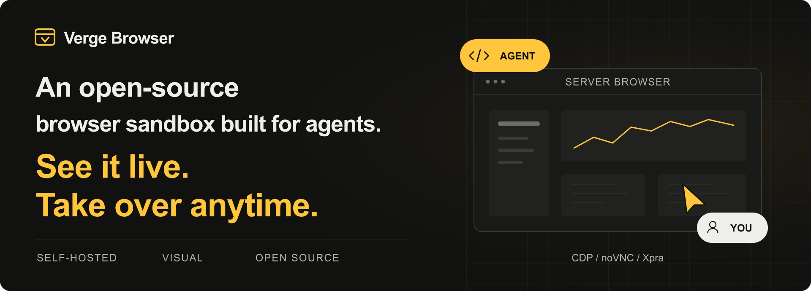
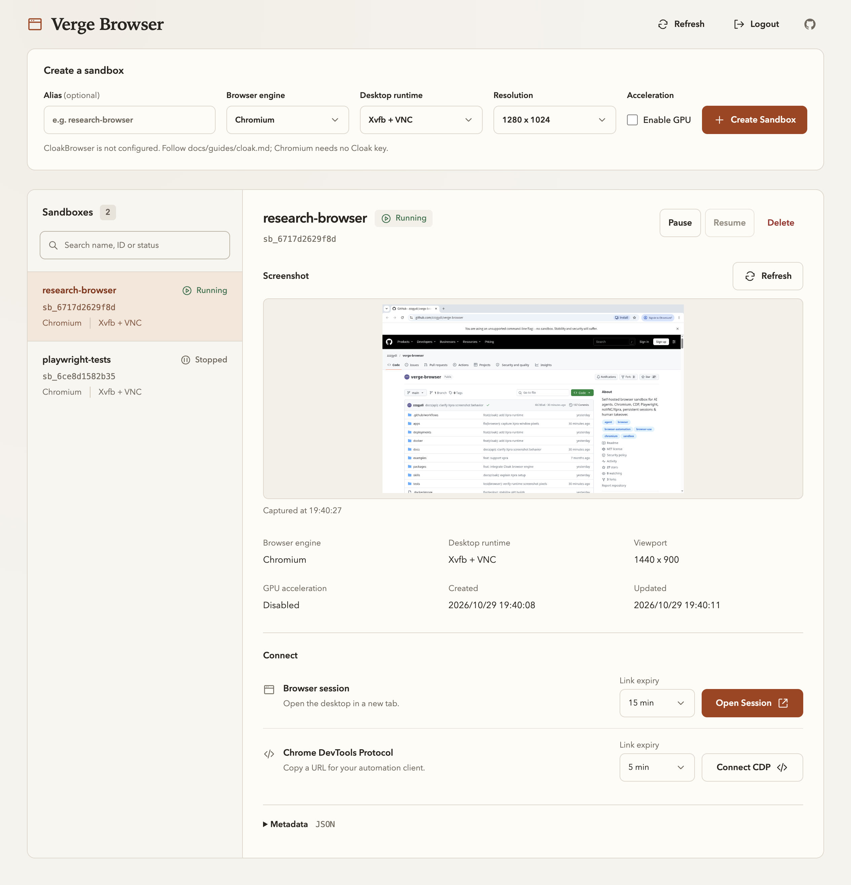

  

  Deploy it on your own server. 
  Watch your agent browse the web in real time, right from your browser. 
  When it reaches a login screen or gets stuck, pause automation and step in.

  <a href="docs/guides/headless-linux.md"><strong>Deploy to a server →</strong></a>&emsp;
  <a href="docs/guides/usage.md">Usage</a>&emsp;
  <a href="docs/guides/development.md">Development</a>&emsp;
  <a href="README.zh.md">中文</a>

---

## Features

- **Self-hosted browser**: run GUI Chromium in Docker on a Linux server, independently of your personal computer.
- **Agent automation**: connect through CDP with Playwright or Puppeteer, or use the SDK, CLI, and REST API.
- **Live view and manual control**: view the browser through noVNC or Xpra; pause automation before taking over.
- **Persistent workspaces**: each sandbox has its own browser profile and shared files, preserved across pause and resume.
- **Remote access**: use compatible mobile or cloud agents when the service is reachable. See [access requirements](docs/guides/usage.md#phone-and-remote-access).

Dashboard preview

 

## Getting Started

Requires a Linux Docker host with Docker Compose. The host does not need a desktop environment.

1. Set up the service using the [server deployment guide](docs/guides/headless-linux.md), or follow the [local Docker setup](docs/guides/deployment.md).
2. Open `/admin` at your service address and sign in with the configured admin token.
3. Create a sandbox, open its visual session, or connect your agent using the [usage guide](docs/guides/usage.md).

The current deployment model targets a single node in a trusted environment. See [compatibility and limits](docs/guides/usage.md#compatibility-and-limits) for isolation and persistence boundaries.

## Documentation

| Topic | Guides |
| --- | --- |
| Deployment | [Docker setup](docs/guides/deployment.md), [Linux server](docs/guides/headless-linux.md), [environment variables](docs/env.md) |
| Usage | [Usage guide](docs/guides/usage.md), [human handoff](docs/guides/human-handoff.md), [persistent profiles](docs/guides/persistent-profiles.md) |
| Clients & API | [SDK & CLI](docs/cli-sdk.md), [API reference](docs/api.md) |
| Integrations | [Codex](docs/integrations/codex.md), [Playwright MCP](docs/integrations/playwright-mcp.md), [DeepSeek Harness preview plugin](packages/dsh-plugin/README.md) |
| Agent Skills | [Deployment skill](skills/verge-browser-deploy/SKILL.md), [usage skill](skills/verge-browser-usage/SKILL.md) |

## Development & Contributing

The project uses Python / FastAPI, React, and Docker. See the [development guide](docs/guides/development.md) for local setup, project structure, and tests.

Bug reports and pull requests are welcome. Include reproduction steps for bugs and relevant validation for code changes. Report vulnerabilities privately as described in [SECURITY.md](SECURITY.md).

## License

Original source code is [MIT licensed](LICENSE). Runtime images include separately licensed components, including Xpra (GPL v2 or later). See [third-party notices](THIRD_PARTY_NOTICES.md) and [image distribution guidance](docs/open-source-compliance.md).
