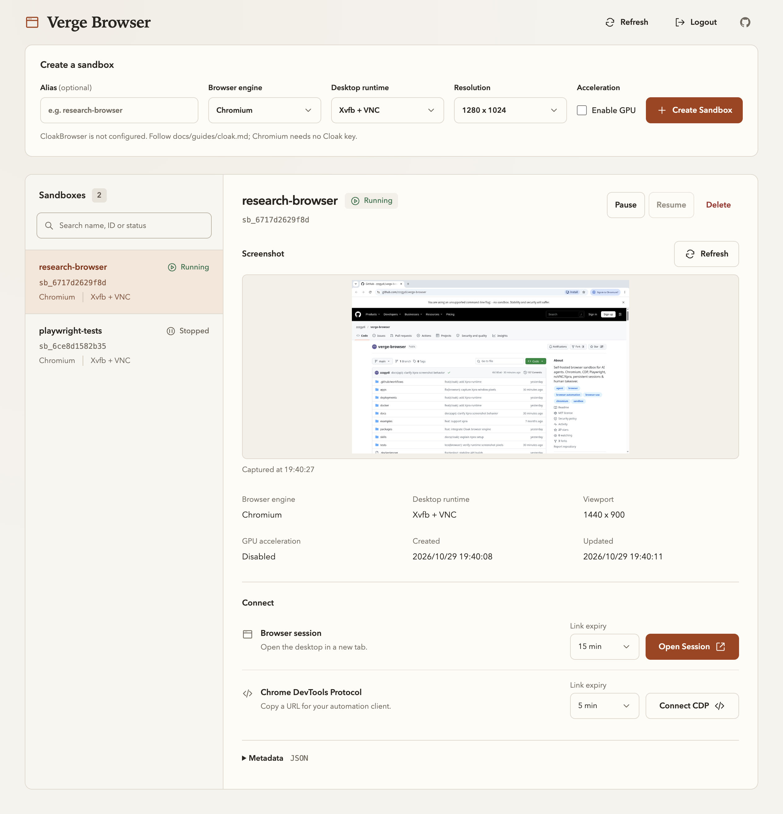
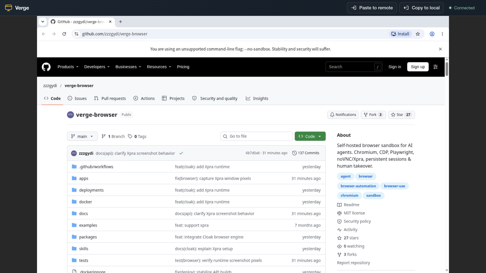

# Verge Browser

[English](./README.md) | 中文

**自托管的可视化浏览器沙箱。AI Agent 与人共用同一浏览器。**

在没有桌面的 Linux 服务器上运行图形界面 Chromium。
Agent 通过 Playwright 连接 CDP 操作网页。
人通过 noVNC 或 Xpra 查看并操作同一个浏览器。
人工登录或执行多因素认证（MFA）前，必须停止自动化。
每个沙箱都有独立的浏览器 Profile 和共享文件。

[快速开始](#快速开始) · [Linux 服务器部署](./docs/guides/headless-linux.md) · [Codex + Playwright MCP](./docs/integrations/codex.md) · [人工接管](./docs/guides/human-handoff.md)

<p align="center">
  
</p>
<p align="center">
  <strong>管理控制台</strong> · 搜索沙箱、查看状态，无需打开会话即可预览选中沙箱的浏览器画面。
</p>

<details>
<summary>查看 noVNC 会话</summary>

<p align="center">
  
</p>

会话提供同一浏览器的人工操作入口。
工具栏按钮在本机与沙箱间传送剪贴板文本。
两张截图来自真实的 Chromium / Xvfb + VNC 沙箱。
浏览器显示本仓库的公开 GitHub 页面。

</details>

## 核心能力

- **图形界面 Chromium**：使用可见桌面中的标签页、下载和弹窗。
- **CDP 自动化**：通过 WebSocket 连接 Playwright 或 Puppeteer。
- **窗口截图**：抓取完整浏览器窗口。在控制台选中运行中的沙箱可以预览和刷新。
- **人工接管**：为 noVNC 和 Xpra 提供统一会话入口。
- **文件共享**：浏览器与 API 共用 `/workspace`，用于上传、下载和产物交换。
- **持久化浏览器 Profile**：暂停后恢复可以复用磁盘文件。不保证恢复相同标签页或浏览器内存。

## 适用场景

- 在 Linux VPS 上运行可视化浏览器。宿主机不依赖桌面环境。
- 给编程 Agent 提供远程浏览器，测试浏览器可以访问的 Web 应用。
- 人工完成登录或 MFA 后，让 Agent 在同一个浏览器中继续操作。
- 为不同任务或账号保留独立的浏览器 Profile 和文件。
- 直接查看远程浏览器任务，不必搬到本机浏览器重做。

## 兼容性与边界

| 能力 | 支持范围与限制 |
| --- | --- |
| Linux 自托管 / Docker | 支持单节点部署。宿主机不依赖桌面。容器内运行图形界面 Chromium。 |
| Playwright / Puppeteer | 通过带票据的 CDP WebSocket 连接，不是 Playwright 协议服务 |
| Codex / Playwright MCP | 通过 CDP 连接外部工具。必须配置客户端和更新票据。不内置 Codex 任务编排。 |
| 人工接管 | noVNC 或 Xpra 操作同一浏览器。接管前，调用方必须停止 Agent 操作。 |
| Profile 与文件持久化 | 暂停和恢复保留磁盘数据。删除沙箱会删除数据。不保证网站登录始终有效。 |
| 多沙箱 | 使用独立容器和工作目录，不是经过强化隔离的非互信多租户服务 |
| GUI 截图 | 支持浏览器窗口截图，也支持通过 CDP 截取页面 |

本地页面自动化不需要远程桌面时，可以直接使用 Playwright。
自动化与人工操作必须共用远程浏览器时，使用 Verge Browser。

## 集成指南

DSH 插件提供[中文安装说明](./packages/dsh-plugin/README.zh.md)。
预览版适配 DSH `0.2.1-rc.2`。
插件提供 Chromium/Camoufox 的会话工具和人工接管。

以下指南目前以英文维护：

- [Codex 连接自托管浏览器](./docs/integrations/codex.md)：配置 Playwright MCP、使用限定沙箱的 CDP 票据，并交给人接管。
- [Playwright 和 Playwright MCP 连接 CDP](./docs/integrations/playwright-mcp.md)：连接现有浏览器，而不是另起一个浏览器。
- [无桌面的 Linux 服务器部署](./docs/guides/headless-linux.md)：通过 SSH 隧道访问，不直接暴露 API。
- [人工接管](./docs/guides/human-handoff.md)：停止自动化、完成手动步骤、重新读取页面后继续。
- [浏览器 Profile 持久化](./docs/guides/persistent-profiles.md)：说明暂停、恢复、重启和删除分别保留什么。
- [CloakBrowser 内核](./docs/guides/cloak.md)：配置许可证密钥并私有安装。未验证：真实授权内核的运行。
- [Camoufox 内核](./docs/guides/camoufox.md)：使用命令 API，不使用 CDP。浏览器必须单独安装。

## Agent Skills

仓库提供面向 AI Agent 的 Skills，位于 [`skills/`](./skills)：

- [`skills/verge-browser-deploy`](./skills/verge-browser-deploy)：用于部署 Verge Browser、配置环境变量、验证服务健康状态以及排查启动问题
- [`skills/verge-browser-usage`](./skills/verge-browser-usage)：管理已有服务中的沙箱，并结合 `agent-browser` 执行自动化

## 快速开始

### 方式一：Docker Compose（推荐）

下列命令仅用于可信的本地开发环境。
不得将这个开发示例直接暴露到公网。
它向全部网络接口发布 8000 端口，并使用开发密钥。
在仓库根目录执行。

```bash
export PROJECT_ROOT="$PWD"
docker compose -f deployments/docker-compose.yml build api runtime-xvfb runtime-xpra
docker compose -f deployments/docker-compose.yml up api
```

打开 [http://127.0.0.1:8000/admin](http://127.0.0.1:8000/admin) 开始使用。

本地开发未覆盖 `VERGE_ADMIN_AUTH_TOKEN` 时，可以用 `dev-admin-token` 登录。

服务器部署使用 [Linux 私有部署指南](./docs/guides/headless-linux.md)。

部署环境变量见 [`docs/env.md`](./docs/env.md)。

### 方式二：本地开发

前置依赖：

- Python 3.11+
- Node.js 22+，并启用 Corepack / pnpm
- Docker

1. 安装依赖

```bash
python3 -m venv .venv
source .venv/bin/activate
pip install -e ".[dev]"
```

2. 安装并构建管理页

```bash
corepack enable
pnpm --dir apps/admin-web install --frozen-lockfile
pnpm --dir apps/admin-web build
```

该命令会把静态产物输出到 `apps/api-server/app/static/admin`。

3. 构建运行时镜像

```bash
docker build -f docker/runtime-xvfb.Dockerfile -t verge-browser-runtime-xvfb:latest .
docker build -f docker/runtime-xpra.Dockerfile -t verge-browser-runtime-xpra:latest .
```

4. 启动 API 服务器

必须保持开发服务器私有。`--host 0.0.0.0` 监听全部网络接口。

```bash
uvicorn app.main:app --app-dir apps/api-server --host 0.0.0.0 --port 8000 --reload
```

API 地址：[http://127.0.0.1:8000](http://127.0.0.1:8000)。
管理页地址：[http://127.0.0.1:8000/admin](http://127.0.0.1:8000/admin)。

### 方式三：Docker 部署

必须保持 API 私有。命令向全部网络接口发布 8000 端口。
公网服务器使用[私有部署指南](docs/guides/headless-linux.md)。

在 Docker 中运行 API 服务，并通过宿主机 Docker socket 管理运行时容器。

```bash
# 构建运行时镜像
docker build -f docker/runtime-xvfb.Dockerfile -t verge-browser-runtime-xvfb:latest .
docker build -f docker/runtime-xpra.Dockerfile -t verge-browser-runtime-xpra:latest .

# 构建 API 服务器镜像（同时打包管理页）
docker build -f docker/api-server.Dockerfile -t verge-browser-api:latest .

# 创建沙箱持久化目录
mkdir -p .local/sandboxes

# 对外暴露服务前请设置非默认鉴权密钥
export VERGE_ADMIN_AUTH_TOKEN="replace-with-a-long-random-token"
export VERGE_TICKET_SECRET="replace-with-a-long-random-ticket-secret"

# 运行 API 服务器容器
docker run -d \
  --name verge-api \
  -p 8000:8000 \
  -v /var/run/docker.sock:/var/run/docker.sock \
  -v "$(pwd):$(pwd)" \
  -e VERGE_SANDBOX_BASE_DIR="$(pwd)/.local/sandboxes" \
  -e VERGE_ADMIN_AUTH_TOKEN="$VERGE_ADMIN_AUTH_TOKEN" \
  -e VERGE_TICKET_SECRET="$VERGE_TICKET_SECRET" \
  -w "$(pwd)" \
  verge-browser-api:latest
```

> **说明**：Linux 主机使用 GPU 加速时，必须在 `docker run` 中加入设备参数。API 容器通过该参数检测显卡：
>
> - **Intel / AMD**：`--device /dev/dri:/dev/dri`
> - **NVIDIA**：`--gpus all`。宿主机必须先安装 [nvidia-container-toolkit](https://docs.nvidia.com/datacenter/cloud-native/container-toolkit/latest/install-guide.html)。

API 容器与宿主机必须使用相同的项目绝对路径。
运行时容器通过该路径挂载沙箱工作目录。

完整的部署环境变量清单见 [`docs/env.md`](./docs/env.md)。

### 基本用法示例

按 [CLI 指南](docs/cli-sdk.md)配置 `VERGE_BROWSER_URL` 和 `VERGE_BROWSER_TOKEN`。
示例依赖运行中的 API。

安装 CLI：

```bash
npm install -g verge-browser
```

创建沙箱：

```bash
verge-browser sandbox create --alias test --width 1440 --height 900
```

截图：

```bash
verge-browser browser screenshot test --output ./screenshot.png
```

把目标动作写入 `actions.json`。格式见 [API 文档](docs/api.md)。

执行 GUI 动作：

```bash
verge-browser browser actions test --input ./actions.json
```

获取人工接管链接：

```bash
verge-browser sandbox session test
```

更多命令详见 [`docs/cli-sdk.md`](./docs/cli-sdk.md)。

## 开发指南

### 管理页开发

只修改管理页时，可以单独启动 Vite 开发服务器：

```bash
pnpm --dir apps/admin-web dev
```

默认访问地址为 [http://127.0.0.1:5173](http://127.0.0.1:5173)。

### 运行测试

必须在没有业务沙箱的 Docker 环境中运行。
`test_runtime_api.py` 的清理逻辑会删除全部受管容器。

运行测试集：

```bash
PYTHONPATH=apps/api-server pytest
```

运行时改动使用下列本地验证命令：

```bash
docker build -f docker/runtime-xvfb.Dockerfile -t verge-browser-runtime-xvfb:latest .
docker build -f docker/runtime-xpra.Dockerfile -t verge-browser-runtime-xpra:latest .
PYTHONPATH=apps/api-server pytest tests/unit tests/integration/test_runtime_api.py
```

### 手动冒烟脚本

冒烟测试脚本位于 [`tests/scripts`](./tests/scripts)。

常见流程：

- `tests/scripts/create-sandbox.sh`：创建沙箱并打印所需的 ID 和后续 URL
- `tests/scripts/get-session-url.sh`：创建或复用沙箱，并打印会话 URL
- `tests/scripts/browser-smoke.sh`：将浏览器元数据以及窗口和页面截图保存到 `tests/scripts/.artifacts/`
- `tests/scripts/files-smoke.sh`：针对 `/workspace` 演练文件 API
- `tests/scripts/restart-browser.sh`：重启 Chromium 并在前后保存浏览器信息
- `tests/scripts/full-manual-tour.sh`：运行创建、截图、文件和会话流程
- `tests/scripts/cleanup-sandbox.sh`：当传入 `SANDBOX_ID=...` 时删除沙箱

示例：

```bash
tests/scripts/full-manual-tour.sh
```

API 使用其他地址时，必须把下列变量改为实际地址：

```bash
export VERGE_BROWSER_URL="http://127.0.0.1:8000"
```

管理 API 必须携带管理令牌。设置：

```bash
export VERGE_BROWSER_TOKEN="<admin-token>"
```

### 清理开发容器

执行前，必须确认可以删除全部受管开发容器。
命令会强制删除当前 Docker 中标记为 `verge.managed=true` 的全部容器。

删除容器：

```bash
docker ps -aq --filter "label=verge.managed=true" | xargs -r docker rm -f
docker rm -f verge-api 2>/dev/null || true
```

执行完整清理前，必须备份数据。
下列命令还会删除 `.local/sandboxes` 中的 Profile 和共享文件。

删除容器与持久化数据：

```bash
docker ps -aq --filter "label=verge.managed=true" | xargs -r docker rm -f
rm -rf .local/sandboxes
```

使用 `down` 停止 Compose 服务。
确认可以删除卷时，再使用 `down -v`：

```bash
docker compose -f deployments/docker-compose.yml down
docker compose -f deployments/docker-compose.yml down -v
```

### 开发说明

- 项目目标 Python 3.11+。
- API 服务器使用 FastAPI 实现。
- WebSocket 代理转发 CDP 和会话连接。
- 文件操作限制在沙箱工作目录内。
- 容器化 API 通过 `/var/run/docker.sock` 管理宿主机上的沙箱容器。
- 当前实现面向单节点使用，不提供多租户编排。

## API 接口说明

当前 API 采用 `/sandbox/{sandbox_id}/...` 路由模型。

详细端点文档位于 [`docs/api.md`](./docs/api.md)。

SDK 与 CLI 使用示例位于 [`docs/cli-sdk.md`](./docs/cli-sdk.md)。

### 接口范围

Verge Browser 聚焦于浏览器控制：

- 浏览器生命周期：create、pause、resume、delete
- 基于 CDP 的浏览器自动化
- GUI 截图与输入动作
- 基于 `xvfb_vnc` 或 `xpra` 的人工接管
- 通过沙箱工作目录交换文件

API 不提供任意 Shell 命令执行。

## 项目架构

### 整体架构

平台分为两部分：

1. API 服务器
   提供 REST 和 WebSocket 端点。端点管理沙箱、浏览器和文件。端点也转发 CDP 和带票据的会话。
2. 沙箱运行时
   在单个隔离容器中运行 Chromium、桌面栈以及共享 `/workspace`。

```text
客户端 / Agent / 人工
        |
        v
+------------------------------+
| FastAPI 网关 / API 服务器    |
| 认证 + REST + WS + 票据      |
+------------------------------+
        |
        v
+-----------------------------------------------+
| 沙箱运行时容器                                |
| xvfb_vnc 或 xpra + Chromium + /workspace      |
+-----------------------------------------------+
```

### 技术说明

项目面向本地开发和单节点部署。

当前源码包含：

- 运行时容器启动，包含 Chromium、Xvfb/Openbox 或 Xpra，以及 CDP 中继
- 通过 API 创建沙箱
- 持久化沙箱元数据。服务启动时重新关联运行中的容器。其他记录保持 `STOPPED`。
- 复用工作目录的 `pause` / `resume`
- 真实窗口截图
- 通过 CDP 截取页面
- 通过 `xdotool` 执行 GUI 操作
- 面向 noVNC 和 Xpra 的票据会话入口
- 工作目录内的文件列表、读取、写入、上传、下载和删除操作
- 管理页构建为静态资源，并由 API 在 `/admin` 路径下提供
- 运行时 Dockerfile、supervisor 配置、启动脚本和基于 Docker 的集成测试

后续加固范围：

- 更强的 Docker 生命周期管理和基于健康检查的状态转换
- 面向生产的浏览器崩溃恢复和降级状态处理
- 文件与浏览器的集成覆盖
- 更广泛的端到端与故障模式覆盖

### 仓库结构

```text
apps/
  api-server/         FastAPI 应用程序
  admin-web/          Vite + React 管理页，构建后进入 API 静态资源目录
  runtime-xvfb/       Xvfb + VNC 运行时资源
  runtime-xpra/       Xpra 运行时资源
deployments/          本地部署资源
docker/               运行时与 API 容器构建文件
tests/                单元测试与集成测试
docs/                 产品、API 与技术文档
```

### 运行时镜像

运行时镜像包含：

- Chromium
- xdotool
- supervisor
- TCP 中继。它提供稳定的 CDP 入口，转发到 Chromium 的内部调试端口。

当前支持两种运行时变体：

- `xvfb_vnc`：Xvfb + Openbox + x11vnc + noVNC / websockify
- `xpra`：Xpra server + HTML5 客户端资源

### 两种桌面方案对比

| 特性 | `xvfb_vnc` | `xpra` |
| --- | --- | --- |
| 桌面组件 | Xvfb + Openbox + x11vnc + noVNC | Xpra Server + HTML5 客户端 |
| 剪贴板 | 显式文本传输按钮。见[剪贴板用法](docs/vnc_clipboard.md)。 | Xpra 客户端剪贴板功能。必须在目标浏览器验证。 |
| 创建字段 | `kind: "xvfb_vnc"` | `kind: "xpra"` |

本文不提供延迟或网络性能基准测试。

如何选择：

- 以自动化为主，只偶尔人工查看：使用 `xvfb_vnc`
- 频繁人工接管或远程调试：使用 `xpra`

## 许可证

本仓库中的原创源码采用 MIT 许可证。参见 [LICENSE](./LICENSE)。

运行时镜像包含使用其他许可证的第三方组件。
`runtime-xpra` 镜像安装 Xpra。
Xpra 使用 GPL v2 或更高版本，并保持其许可条款。

对外分发镜像前，必须查看 [THIRD_PARTY_NOTICES.md](./THIRD_PARTY_NOTICES.md) 和[合规说明](./docs/open-source-compliance.md)。
