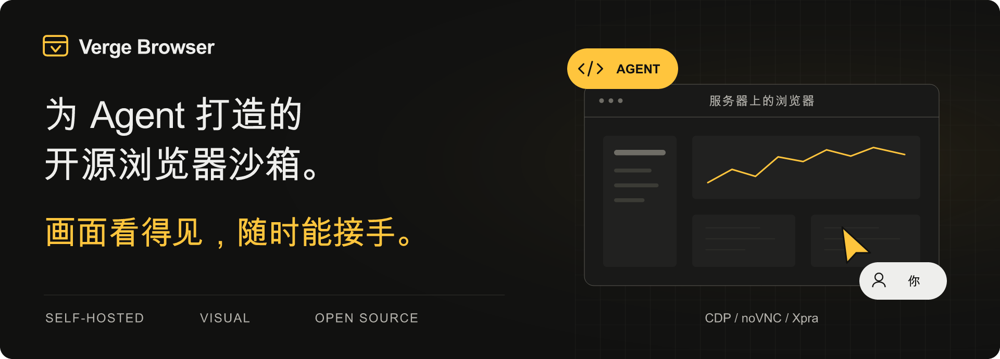

  

  部署在你的服务器上。 
  Web 端实时查看 Agent 网页操作，遇到登录或卡点，随时暂停并亲自上手。

  <a href="docs/guides/headless-linux.md"><strong>部署到服务器 →</strong></a>&emsp;
  <a href="docs/guides/usage.zh.md">使用指南</a>&emsp;
  <a href="docs/guides/development.zh.md">开发指南</a>&emsp;
  <a href="README.md">English</a>

---

## 功能

- **自托管浏览器**：在 Linux 服务器的 Docker 容器中运行图形界面 Chromium，不依赖个人电脑在线。
- **Agent 自动化**：通过 CDP 接入 Playwright 或 Puppeteer，也可使用 SDK、CLI 与 REST API。
- **实时查看与人工操作**：通过 noVNC 或 Xpra 查看浏览器画面，暂停自动化后接管。
- **持久化工作目录**：每个沙箱拥有独立的浏览器 Profile 与共享文件，暂停、恢复时保留磁盘数据。
- **远程访问**：服务可达时，可接入兼容的手机或云端 Agent。具体条件见[远程访问说明](docs/guides/usage.zh.md#手机与异地访问)。

控制台预览

 

## 快速开始

需要支持 Docker 与 Docker Compose 的 Linux 主机，宿主机无需安装桌面环境。

1. 按[服务器部署指南](docs/guides/headless-linux.md)启动服务，或通过 [Docker 部署指南](docs/guides/deployment.zh.md)在本地体验。
2. 打开服务地址下的 `/admin`，使用配置的管理令牌登录。
3. 创建沙箱，打开可视化会话，或按[使用指南](docs/guides/usage.zh.md)连接 Agent。

当前部署方式面向可信环境中的单节点使用。隔离与持久化限制见[兼容性与边界](docs/guides/usage.zh.md#兼容性与边界)。

## 文档

| 主题 | 入口 |
| --- | --- |
| 部署 | [Docker 部署](docs/guides/deployment.zh.md)、[Linux 服务器](docs/guides/headless-linux.md)、[环境变量](docs/env.md) |
| 使用 | [使用指南](docs/guides/usage.zh.md)、[人工接管](docs/guides/human-handoff.md)、[Profile 持久化](docs/guides/persistent-profiles.md) |
| 客户端与 API | [SDK 与 CLI](docs/cli-sdk.md)、[API 文档](docs/api.md) |
| 工具集成 | [Codex](docs/integrations/codex.md)、[Playwright MCP](docs/integrations/playwright-mcp.md)、[DeepSeek Harness 预览版插件](packages/dsh-plugin/README.zh.md) |
| Agent Skills | [部署 Skill](skills/verge-browser-deploy/SKILL.md)、[使用 Skill](skills/verge-browser-usage/SKILL.md) |

部署、使用、开发指南及 DSH 插件提供中文版本，其余链接文档以英文维护。

## 开发与贡献

项目使用 Python / FastAPI、React 和 Docker。开发环境、项目结构及测试方法见[开发指南](docs/guides/development.zh.md)。

欢迎提交问题反馈和 Pull Request。问题反馈请附复现步骤，代码改动请附相关验证结果。安全漏洞请按 [SECURITY.md](SECURITY.md) 私下报告。

## 许可证

原创源码采用 [MIT 许可证](LICENSE)。运行时镜像包含单独授权的第三方组件，其中 Xpra 使用 GPL v2 或更高版本。对外分发镜像前，请阅读[第三方声明](THIRD_PARTY_NOTICES.md)与[镜像分发说明](docs/open-source-compliance.md)。
